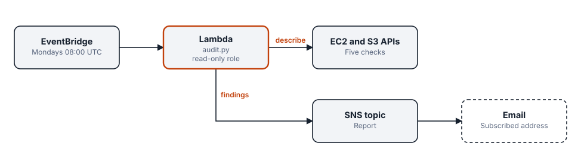

# Cost and security guardrail

A weekly report on the things that quietly cost money or weaken security in an AWS account. A scheduled **Lambda** function checks the account and emails what it finds through **SNS**.



## What it checks

**Cost**

- EBS volumes that are not attached to anything
- Elastic IPs that are not associated with anything
- EC2 instances missing required tags (`Owner` and `Project` by default)

**Security**

- Security groups that allow SSH (22) or RDP (3389) from `0.0.0.0/0` or `::/0`
- S3 buckets without all four public access blocks switched on

## Why I built it

On a service desk, small things left alone become incidents. Cloud accounts are the same: a forgotten volume keeps billing and an open SSH rule keeps waiting. I wanted a report that turns up every Monday so the cleanup happens.

The function is read-only by design. Its IAM role can describe resources and publish to one SNS topic. It cannot change or delete anything, so it is safe to run in any account.

## Deploy

Requires the AWS SAM CLI (already installed in AWS CloudShell).

```bash
sam build
sam deploy --guided --stack-name resource-guardrail
```

Confirm the SNS subscription email. To get a report straight away:

```bash
aws lambda invoke --function-name $(aws cloudformation describe-stack-resource \
  --stack-name resource-guardrail --logical-resource-id AuditFunction \
  --query StackResourceDetail.PhysicalResourceId --output text) /dev/stdout
```

## Test

The tests use [moto](https://github.com/getmoto/moto) to fake AWS, so they need no account.

```bash
pip install pytest moto boto3
pytest
```

## Remove

```bash
sam delete --stack-name resource-guardrail
```

## What I learned

- Paginators, so the checks still work in an account with hundreds of resources.
- How to tell "all traffic" rules from port ranges when reading security group rules.
- Writing tests against fake AWS services, so I can prove each check works without creating bad resources on purpose.

## What I would add next

- Run across every region and every account in an AWS Organization.
- Estimated monthly cost next to each finding.
- AWS Config rules for the checks that Config already supports.

---

*Part of my AWS portfolio. More at [vithu.cloud](https://vithu.cloud).*
